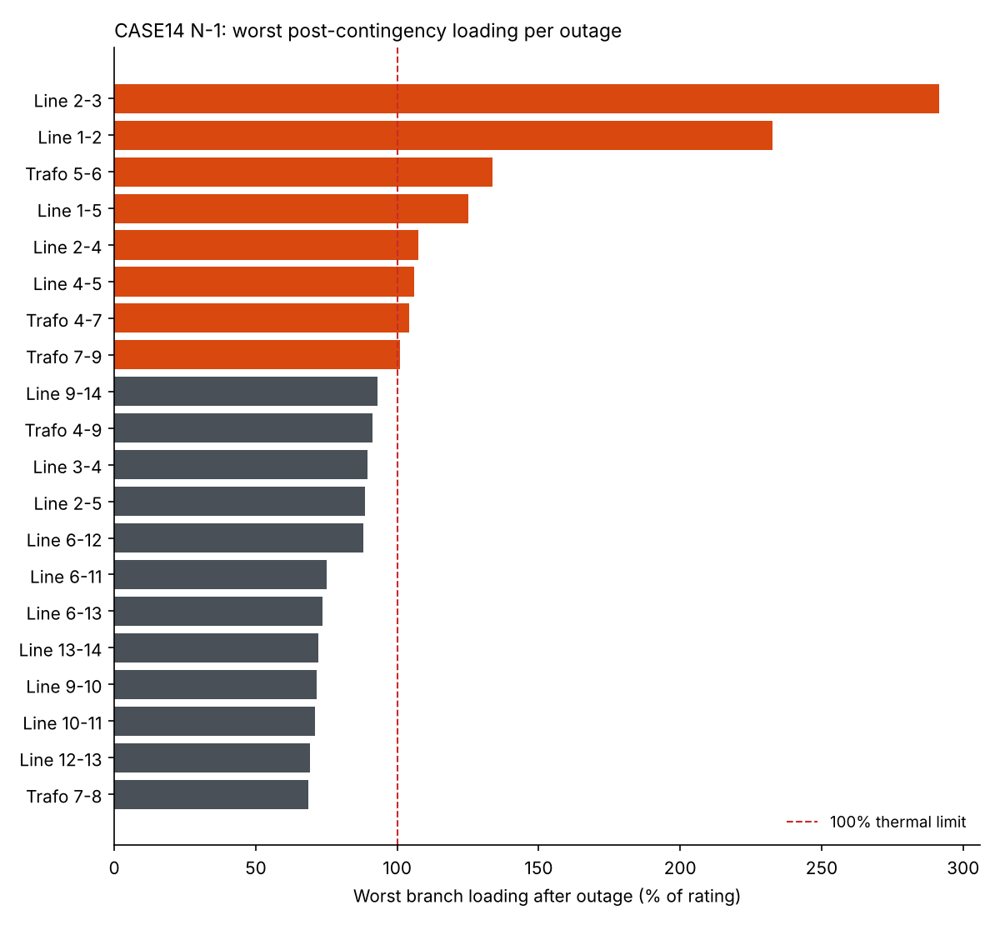

# grid-loadflow-lab ⚡


**Automated N-1 contingency screening for IEEE test systems, in Python.**
Takes every line and transformer out of service one at a time, re-runs the AC load flow, and reports thermal overloads, voltage violations, islanding and non-convergence — in an Excel workbook and a chart.



---

## Results: IEEE 14-bus

20 contingencies (15 lines + 5 transformers), default settings:

| Status | Count |
|---|---|
| Violation | 8 |
| Islanding | 1 |
| OK | 11 |
| Not converged | 0 |

**Key findings**

1. **Line 2–3 outage is the most severe.** Its flow reroutes through Line 3–4, which reaches ~290% of rating.
2. **Line 1–2 is the critical corridor.** It carries ~158 MVA in the base case, the largest flow in the system. Losing it pushes Line 1–5 to ~230%.
3. **Transformer 7–8 is a radial connection.** Its outage islands bus 8 (the synchronous condenser), so the system loses reactive support there.

Full results, including per-violation detail, are in [`results/case14_n1_report.xlsx`](results/case14_n1_report.xlsx).

---

## ⚠️ The rating assumption (read this before the numbers)

pandapower's IEEE cases have **no real thermal limits**: lines are rated 42 kA and transformers 9,900 MVA, so every branch reads ~1% loaded. This tool therefore assigns ratings explicitly:

```
rating = max(margin × base-case MVA flow, floor)        default: margin 1.5, floor 30 MVA
```

These ratings are a study assumption, not equipment data, and the results depend on them heavily:

| Margin | Floor (MVA) | Violations | OK |
|---|---|---|---|
| 1.3 | 10 | 18 | 1 |
| **1.5** | **30** | **8** | **11** |
| 2.0 | 30 | 3 | 16 |

The same three outages (Lines 2–3, 1–2 and Transformer 5–6) violate in every scenario. **Those are the robust findings**; the rest depend on the assumption. If you have nameplate ratings, pass them in with `--ratings` (see below).

---

## Run it

```bash
git clone https://github.com/lakshmi-devadas/grid-loadflow-lab.git
cd grid-loadflow-lab
pip install -r requirements.txt

python run_study.py                         # IEEE 14-bus, default settings
python run_study.py --case case30           # IEEE 30-bus (also: case57)
python run_study.py --margin 2.0            # looser derived ratings
python run_study.py --ratings my.csv        # your own ratings: element,idx,rating_mva
python run_study.py --vmin 0.94 --vmax 1.06 # tighter voltage band
```

Outputs go to `results/`: `<case>_n1_report.xlsx` (settings, base case, N-1 summary colour-coded by status, all violations) and `<case>_n1_loading.png`.

Run the tests with `python -m pytest -q`.

## How it works

```
gridlab/
├── network.py      load case, run power flow, compute branch MVA flows, assign ratings
├── contingency.py  N-1 loop: outage → islanding check → AC power flow → limit checks → restore
└── report.py       Excel workbook + chart
run_study.py        command-line entry point
tests/              7 tests, including known IEEE 14-bus behaviour
```

- **Loading** uses apparent power, the larger of the two branch ends: `S = √(P² + Q²)`.
- **Islanding** is detected topologically, as buses with no path to a generator or slack, *before* the load flow runs.
- **Non-convergence** is caught and reported rather than crashing the study.
- The network is **always restored** after each outage (a `try/finally` block), and a test checks this.
- Bus numbers follow the **IEEE 1-based convention**, so results match published single-line diagrams. pandapower uses 0-based indices internally.

## What I learned
- **Test cases aren't study-ready.** pandapower's IEEE cases carry placeholder ratings (42 kA lines, 9,900 MVA transformers), so every branch read ~1% loaded. I had to set an explicit rating assumption — and the results swung from 18 violations to 3 depending on it. Lesson: always state the ratings basis before quoting N-1 results.
- **Topology matters before load flow.** Transformer 7–8 is the only path to bus 8 (synchronous condenser), so losing it islands the bus and removes reactive support there. I check islanding first so it isn't misreported as a voltage violation.
- **What broke:** My first push failed because I pasted PowerShell commands into a Git Bash terminal. I switched to Git GUI to add the remote and push. Later a GitHub Action failed with "rejected (fetch first)" because the bot had already pushed a newer commit; adding `git pull --rebase` before `git push` fixed it.

## Roadmap

- [ ] Generator outages (N-1 for units, not just branches)
- [ ] Rank contingencies by a performance index instead of the worst single branch
- [ ] DC load flow screening first, then AC only on the flagged cases (faster on large systems)
- [ ] Streamlit front-end to pick the case and limits interactively

## License

MIT
